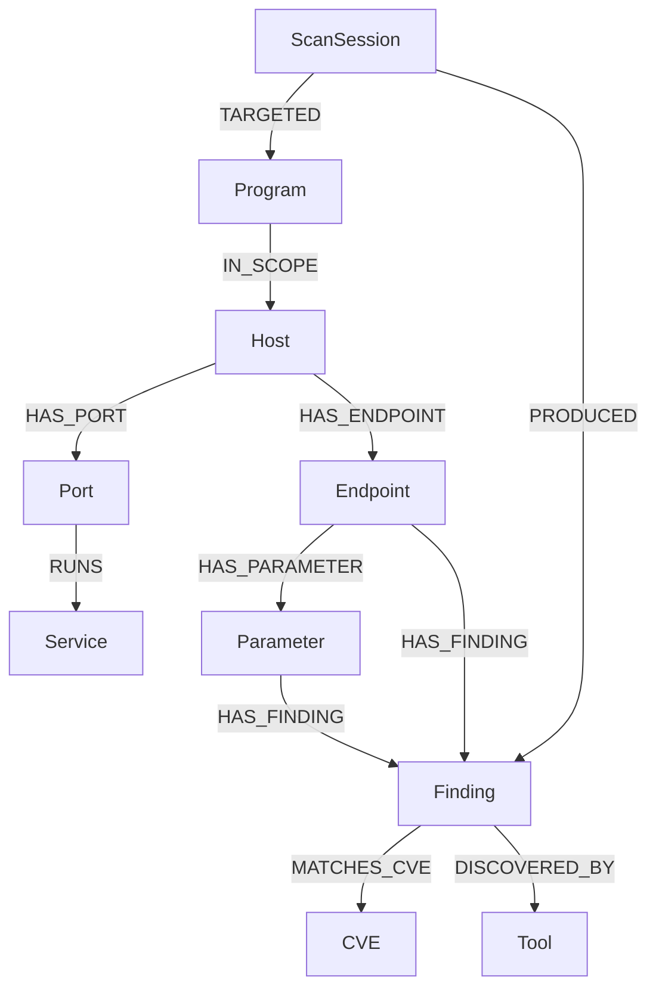

# Wraith — Phase 1: Graph Foundation Service

Wraith is an autonomous bug-bounty pipeline. This is Phase 1: the attack-surface knowledge graph foundation.

## Features
- Neo4j-backed graph database for attack surface modeling.
- FastAPI REST API for CRUD operations.
- Pydantic v2 data models.
- Asynchronous Neo4j driver with connection pooling.
- Idempotent operations using deterministic ID generation.
- Health check endpoint with real Neo4j connectivity check.

## Schema Diagram



## Getting Started

### Prerequisites
- Docker and Docker Compose v2

### Start the stack
```bash
docker compose up -d
```
The API will be available at `http://localhost:8001` and the Neo4j Browser at `http://localhost:7474`.

### Running Tests
```bash
scripts/run_tests.sh all      # everything, inside the containers
scripts/run_tests.sh runner   # active_exploit_runner only
scripts/run_tests.sh sandbox  # kali_sandbox only
scripts/run_tests.sh unit     # the host-runnable subset, no containers needed
```

Tests run **inside** the containers. `active_exploit_runner` reaches postgres,
redis, the live sandbox and juice_shop, and `kali_sandbox` imports the MCP SDK
that only exists in its image — none of which resolve from the host. Run there
instead, the failures looked environmental and the suite quietly shrank: 40
tests in `test_validation.py` had stopped running at all because a module-level
fixture reached for a database that wasn't there.

Each service splits its suite in two, and the split is recorded in its
`pytest.ini` rather than left to whoever reads the output:

| Command | Meaning |
|---|---|
| `pytest -m "not integration"` | needs nothing running — the fast inner loop |
| `pytest -m integration` | needs live services |
| `pytest` | everything |

An unmarked test is expected to be self-contained. `scripts/run_tests.sh` also
brings up a `docker-compose.test.yml` override that bind-mounts `app/` and
`tests/`, so a run exercises the working tree rather than the copy baked into
the image — otherwise a stale image would pass a suite you had already broken.

The sandbox suite is container-only: from a host its `conftest.py` skips
collection and pytest exits **5** ("no tests collected") rather than **0**
("everything passed"). A zero there would claim a success no test was in a
position to make.

Do not override `WRAITH_GATE_SECRET` when running these suites. The runner signs
each grant with it and the sandbox verifies the signature with the same value,
so a substituted secret produces grants the sandbox correctly refuses — which
surfaces as a `403` and reads like a product bug.

## Example API Usage

### 1. Create a Program
```bash
curl -X POST http://localhost:8001/api/v1/programs \
  -H "Content-Type: application/json" \
  -d '{"name": "My Program", "platform": "Bugcrowd", "scope_domains": ["example.com"]}'
```

### 2. Add a Host to a Program
```bash
curl -X POST http://localhost:8001/api/v1/programs/{program_id}/hosts \
  -H "Content-Type: application/json" \
  -d '{"value": "api.example.com"}'
```

### 3. Get the Attack Surface Graph
```bash
curl http://localhost:8001/api/v1/programs/{program_id}/graph
```

## Health Check
```bash
curl http://localhost:8001/health
```

## Optional Egress Interception (recon tools)

By default every recon tool container runs **egress-direct**: no proxy, no
sidecar, no extra volumes. A plain `docker compose up` starts nothing new and
tool command/environment/volumes are byte-identical to the pre-feature build.

When you want decrypted request/response evidence from the interceptable
tools (katana, httpx/httpx-probe), you can OPT IN with two knobs:

1. **Compose profile** — start the interception sidecar:
   ```bash
   docker compose --profile recon-proxy up -d
   ```
   The `mitmproxy_sidecar` service (mitmproxy/mitmproxy) and its
   `mitmproxy_ca` / `mitmproxy_flows` named volumes are only materialized
   under that profile, so a plain `docker compose up` never starts it.

   Under the same profile a one-shot init service, `mitmproxy_volumes_init`,
   chowns both named volumes to uid 1000 before the sidecar starts, and the
   sidecar waits for it to exit 0. This is required because mitmproxy's
   entrypoint drops to the unprivileged `mitmproxy` user while Docker creates
   fresh volumes as `root:root`; without it mitmdump aborts its stream file
   with `Errno 13 Permission denied: /flows/flows.mitm` and generates no CA.
   The init is idempotent, and mitmdump itself still runs unprivileged.

2. **`RECON_PROXY_URL`** on the orchestrator — point tool containers at it.
   Export it for the same invocation rather than committing it to `.env`,
   because a value in `.env` is also interpolated into a plain
   `docker compose up` and would leave the default stack pointing at a
   sidecar that is not running:
   ```bash
   RECON_PROXY_URL=http://mitmproxy_sidecar:8080 \
     docker compose --profile recon-proxy up -d
   ```
   The hostname must match the compose service name
   `mitmproxy_sidecar` (the sidecar publishes no host ports; only the
   internal network reaches it).

   When set, supported tools route HTTP(S) through the sidecar and trust its
   CA (mounted read-only from the named volume), so decrypted evidence lands
   in the streamed flow file — while keeping every tool command/volumes
   byte-identical by default when the variable is empty.

The broker requires **zero changes** (it already forwards
`environment`/`volumes`/`extra_hosts` unchanged, and named volumes pass its
validator). All gating lives in `recon_orchestrator/app/tools/proxy.py`.
