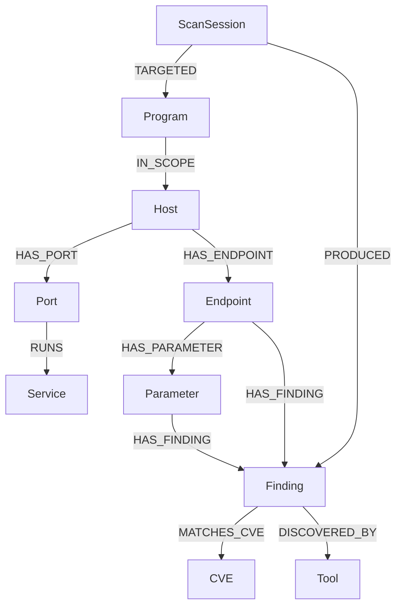

# Wraith — Phase 1: Graph Foundation Service

Wraith is an autonomous bug-bounty pipeline. This is Phase 1: the attack-surface knowledge graph foundation.

## Features
- Neo4j-backed graph database for attack surface modeling.
- FastAPI REST API for CRUD operations.
- Pydantic v2 data models.
- Asynchronous Neo4j driver with connection pooling.
- Idempotent operations using deterministic ID generation.
- Health check endpoint with real Neo4j connectivity check.

## Schema Diagram



## Getting Started

### Prerequisites
- Docker and Docker Compose v2

### Start the stack
```bash
docker compose up -d
```
The API will be available at `http://localhost:8001` and the Neo4j Browser at `http://localhost:7474`.

### Running Tests
```bash
docker compose run graph_api pytest
```

## Example API Usage

### 1. Create a Program
```bash
curl -X POST http://localhost:8001/api/v1/programs \
  -H "Content-Type: application/json" \
  -d '{"name": "My Program", "platform": "Bugcrowd", "scope_domains": ["example.com"]}'
```

### 2. Add a Host to a Program
```bash
curl -X POST http://localhost:8001/api/v1/programs/{program_id}/hosts \
  -H "Content-Type: application/json" \
  -d '{"value": "api.example.com"}'
```

### 3. Get the Attack Surface Graph
```bash
curl http://localhost:8001/api/v1/programs/{program_id}/graph
```

## Health Check
```bash
curl http://localhost:8001/health
```
